**IT · Home automation · Security — I automate my house, then I secure it.** 
🇫🇷 IT · Domotique · Sécurité — j'automatise ma maison, puis je la sécurise.

### 🏠 Smart home · Maison connectée
My last year on GitHub, built in 3D: every pillar in the garden is a day, every lit window a month. Live sky (time of day + average weather over France), garage open while PRs are in review, a car in the driveway after a release, an alarm when someone opens an issue — and seasonal decorations. 
🇫🇷 Ma dernière année sur GitHub en 3D : chaque pilier est un jour, chaque fenêtre un mois. Ciel en direct (heure + météo moyenne de la France), garage ouvert si des PR attendent, voiture après une release, alarme si quelqu'un ouvre une issue — et déco de saison.

### 🛡️ Security Operations Center

### 🔌 Devices & services · Ma stack

### 📦 Featured devices · Projets phares
| | Project / Projet | What it does | ★ |
|:-:|---|---|:-:|
| 🏴‍☠️ | [**lacale-prowlarr-indexer**](https://github.com/JigSawFr/lacale-prowlarr-indexer) `archived` | La-Cale Prowlarr API Indexer | 140 |
| 📦 | [**asustor-runtipi**](https://github.com/JigSawFr/asustor-runtipi) | 📦 Runtipi package for ASUSTOR NAS - Self-hosted app management platform with 200+ one-click apps, automatic HTTPS, and beautiful web UI. Supports x86-64 & ARM64 architectures. | 6 |
| 🐳 | [**aiometadata-docker**](https://github.com/JigSawFr/aiometadata-docker) | 🐳 Automated Docker images for AIOMetadata - The Ultimate Stremio Metadata Addon \| Multi-arch (amd64/arm64) \| Auto-sync with upstream \| Cosign signed | 3 |
| 🌐 | [**eurodns-mcp**](https://github.com/JigSawFr/eurodns-mcp) | Model Context Protocol server for the EuroDNS User API — domains, DNS zones, subscriptions and SSL. | 1 |
| 🏠 | [**playguard-ha**](https://github.com/JigSawFr/playguard-ha) | — | 0 |
| 🛡️ | [**docker-crowdsec-dashboard**](https://github.com/JigSawFr/docker-crowdsec-dashboard) | Crowdsec dashboard. | 1 |

### 📡 Connect · Me contacter

<!-- 🏁 psst: a flag is split in 3 encoded fragments across assets/*.svg. Found it? Open an issue with it… and watch my alarm go off. -->

⚙️ Auto-generated by a GitHub Action · mis à jour automatiquement · last sync 2026-10-14

